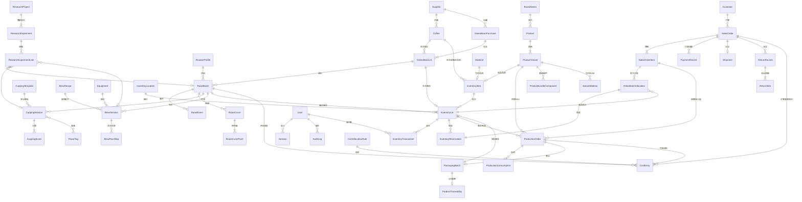

# 資料庫設計

- PostgreSQL 17（正式環境可用 Supabase PostgreSQL）
- Schema：`prisma/schema.prisma`；Migration：`prisma/migrations/`（**一律使用 migration**，不使用 `db push`）
- `20261121101110_init`：資料表、外鍵、唯一索引
- `20261121101200_integrity_constraints`：CHECK constraint、帳本與稽核紀錄不可變 trigger

## Migration 指令

| 情境 | 指令 |
| --- | --- |
| 開發：修改 schema 後建立 migration | `npm run db:migrate -- --name <名稱>` |
| 任何環境：套用尚未執行的 migration | `npm run db:deploy` |
| 需要自訂 SQL（CHECK、trigger） | `npx prisma migrate dev --create-only --name <名稱>`，編輯 SQL 後再 `db:deploy` |

## 共通規則

- 主鍵：UUID；人類可讀編號另存（`batchNo`、`orderNo`、`lotCode`…，皆 unique）
- 重量 `Decimal(14,3)` g；金額 `Decimal(14,2)` TWD；單位成本 `Decimal(18,6)`
- 時間 `timestamptz`（UTC）；日期 `date`
- 外鍵預設 `RESTRICT`：仍被庫存或訂單使用的批次、商品無法刪除；商品以「封存」取代刪除
- 訂單明細保存 SKU、名稱、單價、稅額、成本快照，刪改商品不影響歷史訂單

## ERD

（系統表：`RateLimitBucket`、`ApiKey`、`SystemSetting`、`Attachment`、`BrandAsset`、`DocumentSequence`。）

## 實體對照（任務書概念實體 → 實作）

| 概念實體 | 實作 |
| --- | --- |
| User / AuditLog | `User`、`Session`、`AuditLog` |
| Coffee / Supplier | `Coffee`（含養豆與賞味預設）、`Supplier` |
| GreenBeanPurchase / GreenBeanLot | 採購單 `GreenBeanPurchase` 1:N 生豆批次 `GreenBeanLot`（固定每克成本） |
| RoasterProfile / RoastBatch / RoastEvent / RoastCurve / RoastCurvePoint | 同名；`RoastCurve` 保存原始檔 storageKey、SHA-256、欄位對應 |
| CuppingSession / CuppingScore / FlavorTag | 同名＋`CuppingTemplate`（自訂評分系統）、`CuppingSessionTag` |
| BrewRecipe / BrewSession / BrewPourStep / Equipment | 同名；配方以 `rootId + version` 版本化 |
| ResearchProject / ResearchExperiment | 同名＋`ResearchExperimentLink` |
| InventoryItem / InventoryLot / InventoryLocation / InventoryTransaction / InventoryReservation | 同名（四類庫存以 `InventoryItem.kind` 區分：GREEN／ROASTED／FINISHED／MATERIAL） |
| Material | `Material`＋`VariantMaterial`（SKU 包材 BOM） |
| ProductionOrder / ProductionConsumption / PackagingBatch | 同名；`ProductionConsumption` 多列可支援未來多來源（配方豆） |
| Product / ProductVariant / ProductBundleComponent | 同名 |
| Customer / SalesOrder / SalesOrderItem / OrderBatchAllocation / PaymentRecord / Shipment / ReturnRecord | 同名＋`ReturnItem` |
| CostEntry / CostAllocation | `CostEntry`（估計／實際、計算說明）＋`CostAllocationRule`（保存分攤方式） |
| BrandSeries / ProductTraceability | 同名 |

## CHECK constraint 與 trigger

| 名稱 | 規則 |
| --- | --- |
| `lot_onhand_nonneg` / `lot_reserved_nonneg` / `lot_reserved_le_onhand` | 不可負庫存；保留不超過在庫 |
| `invtx_qty_nonzero` / `invtx_balance_nonneg` | 帳本數量不為 0、結餘不為負 |
| `resv_qty_pos` / `resv_target` | 保留量 > 0，且必須對應訂單明細或生產單 |
| `roast_weights` | 生豆、熟豆 > 0，熟豆 ≤ 生豆 |
| `po_qty_pos` / `po_fill_pos` / `po_loss_nonneg` | 生產數量、填充重量、損耗合理 |
| `bundle_qty_pos` / `bundle_not_self` | 套組組件數量 > 0、不可包含自己 |
| `order_amounts_nonneg` | 訂單金額不為負、退款不超過總額 |
| `inventory_tx_immutable` | 帳本禁止 UPDATE／DELETE |
| `audit_log_immutable` | 稽核紀錄禁止 UPDATE／DELETE |

## 庫存異動類型

入庫、烘焙領料、烘焙產出、杯測耗用、試喝耗用、樣品贈送、分裝耗用、分裝損耗、分裝產出、包材耗用、報廢、盤點調整、出貨扣帳、退貨待檢、退貨轉出待檢區／重新入庫、沖銷。
訂單保留／取消保留記錄於 `InventoryReservation`（狀態 ACTIVE → CONSUMED／RELEASED，保留時間戳記，不刪除）。

## 追溯路徑

`SalesOrder → SalesOrderItem → OrderBatchAllocation → InventoryLot(成品) → PackagingBatch → ProductionOrder → InventoryLot(熟豆) → RoastBatch → GreenBeanLot → GreenBeanPurchase`
反向：任一生豆批次 → 烘焙批次 → 熟豆批次 → 生產單 → 成品批次 → 訂單分配（皆有外鍵與索引）。
